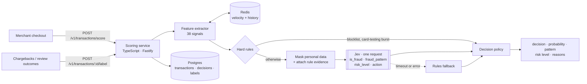

# Vigil

**eCommerce fraud detection with typed decisions from Jev by TypeSafe**, benchmarked honestly against rules and a trained XGBoost model.

Every checkout is enriched with 38 behavioral signals: velocity, device and address history, geography and customer history. With personal data masked, the transaction goes to Jev in **one request answering four typed questions**: a fraud probability (`noul`), a fraud pattern (`choice`), a risk level (`score`) and a recommended action (`choice`). A small, auditable policy turns those answers into allow, step-up, review or block, each with reasons.

## Results

Benchmark on 44,097 held-out simulated transactions, scoring all 882 fraud cases plus a weighted legitimate sample. Full results and method: [docs/benchmark-results.md](docs/benchmark-results.md).

| Strategy | Fraud caught when flagging the top 2% / 3% / 5% of orders | Needs labeled training data | Explains with |
|---|---|---|---|
| Rules | 83.3% / 83.3% / 84.6% | No (hand-written) | Rule codes + pattern |
| XGBoost | **92.6% / 93.7% / 95.0%** | Yes (labeled 120-day history) | A probability |
| Jev | 75.3% / 81.3% / 89.9% | **No** | Typed probability, pattern, risk, action, each with confidence |
| Jev + rules | 80.4% / 87.9% / 90.4% | **No** | Jev's typed answers + rule evidence |

What the numbers say:

- **Jev with no training data comes close to XGBoost.** At a 5% flag budget it catches 90% of fraud; XGBoost reaches 95% but was trained on a labeled 120-day order history (89k orders) from the *same generator* as the test data.
- **Jev is strongest where labels are weakest.** It catches card testing at 95.6% (98.2% with rules) versus XGBoost's 63.9%, because half of card testing is never reported, so the model learned from mislabeled examples. Stolen cards: 96.5%.
- **Rules make Jev more confident.** Passing fired rules to Jev as evidence lifts account-takeover detection from 60% to 76% and promo abuse from 44% to 75%.
- **Operations:** one request per order, 127 ms median and 248 ms p99 latency, about 1,620 input tokens. There were zero errors across 3,761 calls (the 3,418 benchmark calls plus a 343-call pilot).
- **Honest gaps:** Jev's thresholds were never calibrated (XGBoost's are), so Jev adds more 3-D Secure step-ups (2.3% of legitimate orders vs 1.05%). Promo abuse and account takeover remain its weakest scenarios. Everything is synthetic, and the simulator, features and rules share an author.

## How it works



- **Same signals everywhere.** Features are defined once ([contracts/feature_spec.md](contracts/feature_spec.md)) and implemented in TypeScript for serving and Python for training. Golden vectors keep the two identical.
- **Interchangeable strategies.** `rules`, `xgboost`, `jev` and `jev_rules` all run on the same features (`SCORING_STRATEGY`).
- **Safe by construction.**
  - Jev never sees names, emails, card data, IPs, device ids or street addresses.
  - A block needs both a high probability and a confident `block` recommendation; disagreement goes to a human.
  - Rules can raise a Jev decision to review, never to block.
  - If Jev is down, checkout keeps working on rules.

## One decision, end to end

A real account-takeover order from the benchmark: an existing customer, new device, new shipping address, 15× their usual spend, buying gift cards. Full walkthrough with the masked state: [docs/walkthrough.md](docs/walkthrough.md).

| Jev question | Type | Answer |
|---|---|---|
| `is_fraud` | noul | **0.73** |
| `fraud_pattern` | choice | **account_takeover** (95%) |
| `risk_level` | score | **high** (79%; expected level 2.11) |
| `action` | choice | **review** (63%) |

Policy: probability 0.73 is above the 0.6 review threshold, and Jev's confident `review` agrees, so the order goes to **review**:

```json
{
  "decision": "review",
  "fraud_probability": 0.73,
  "pattern": "account_takeover",
  "risk_level": "high",
  "reasons": [
    { "code": "JEV_ASSESSMENT", "message": "Jev: 73% fraud probability, pattern account_takeover (95%), recommends review (63%)" },
    { "code": "NEW_DEVICE_NEW_SHIPPING_HIGH_VALUE", "message": "355.13 USD shipped to a new address from a new device" },
    { "code": "AMOUNT_SPIKE", "message": "Order is 15.29x this customer's average" }
  ],
  "strategy": "jev_rules"
}
```

Without the two rule signals, Jev was unsure (0.50, recommending review with only 47% confidence), so the order would only have been stepped up.

## Quickstart

```bash
uv sync && (cd scoring-service && npm install)
uv run vigil-sim generate --format jsonl --seed 101 --out data/sim/holdout.jsonl
cd scoring-service
npm run eval:offline -- ../data/sim/holdout.jsonl              # rules, offline, no services needed
npm run explain -- ../data/sim/holdout.jsonl txn_00003624      # needs the Jev cache from a benchmark run, or --allow-call
```

## Repository

| Path | What |
|---|---|
| `scoring-service/` | TypeScript scoring API: features, rules, Jev client, XGBoost (ONNX) scorer, policy, benchmark runner |
| `simulator/` | Python simulator: customers, normal traffic, 7 fraud scenarios, delayed labels, `replay` into the API |
| `ml/` | Python feature parity, dataset builder, XGBoost training and ONNX export |
| `benchmark/` | Python weighted metrics and HTML/Markdown report |
| `contracts/` | OpenAPI spec, feature spec, geo table, golden feature vectors |
| `docs/` | Plan, benchmark results, decision walkthrough |

## Prerequisites

- Node.js 20+
- [uv](https://docs.astral.sh/uv/) (Python 3.12 is pinned and installed automatically)
- Docker, for Postgres, Redis and the full stack. The Compose file is provided but hasn't been run end to end yet; development and tests used embedded Postgres (PGlite) and a local Redis binary.

## Setup

```bash
cp .env.example .env                    # then set TYPESAFE_API_KEY (never commit .env)
git config core.hooksPath .githooks     # once per clone: enable the secret-scanning hooks
```

### Secrets

Secrets live only in the untracked `.env`. The git hooks in `.githooks/` scan every commit (`pre-commit`) and everything being pushed (`pre-push`, which also catches `--no-verify` commits). They block:

- `.env` and key files;
- known token formats (TypeSafe, AWS, GitHub, OpenAI/Anthropic, Slack, Google, private keys);
- secret-named variables with literal values;
- any line containing a secret value from your local `.env`, whatever its format.

Findings name the file, never the secret. Deliberately public values go in `.githooks/secrets-allowlist`. To scan the whole history at any time:

```bash
.githooks/check-secrets range "$(git rev-list --max-parents=0 HEAD)..HEAD"
```

### Scoring service

```bash
cd scoring-service
npm install
npm run dev            # http://localhost:8080/health
npm test
```

### Python packages

```bash
uv sync
uv run pytest
```

### Full stack

```bash
docker compose up --build
```

## Simulated data

```bash
uv run vigil-sim generate                              # data/sim/transactions.parquet
uv run vigil-sim generate --format jsonl --seed 101    # data/sim/transactions.jsonl
```

## Rules and policy

- `scoring-service/config/rules.yaml`: hard rules (`action`) decide immediately, and soft rules (`weight`) combine into a 0–1 score. Rules are validated when the file loads.
- `scoring-service/config/policy.yaml`: thresholds for rule scores, Jev's probability and agreement rules (`jev:`), and XGBoost alert-rate budgets (`xgboost:`).
- `SCORING_STRATEGY=rules|xgboost|jev|jev_rules|passthrough` picks the scorer (default `rules`).

To evaluate a rules change offline against labeled data:

```bash
cd scoring-service
npm run eval:offline -- ../data/sim/transactions.jsonl
```

## XGBoost baseline

```bash
uv run vigil-sim generate --format jsonl --seed 7 --days 120 --out data/sim/train.jsonl
uv run vigil-train          # writes models/xgb/{model.onnx,feature_schema.json,parity.json}
SCORING_STRATEGY=xgboost npm --prefix scoring-service run dev
```

- **Point-in-time labels.** Training uses only fraud that had been *reported* at the training cutoff (`--labels truth` turns this off), and evaluation uses ground truth.
- **Maturity gap.** The 21 days before the cutoff are left out of fitting, because most of their fraud hasn't been reported yet.
- **Alert-rate cutoffs.** Cutoffs come from alert-rate budgets in `policy.yaml` (`xgboost.alert_rates`), applied to calibration-window scores, so they need no labels. The service refuses a model calibrated for different rates, or one trained on a different feature list.
- **Checked export.** The export fails if ONNX and XGBoost disagree by more than 1e-5, and a Node test checks the ONNX runtime against Python's probabilities.

Compare strategies offline on a held-out dataset:

```bash
cd scoring-service
npm run eval:offline -- ../data/sim/holdout.jsonl --strategy xgboost
```

## Jev strategies

With `SCORING_STRATEGY=jev` or `jev_rules` (both need `TYPESAFE_API_KEY`), each transaction gets one Jev request that answers four typed questions (see `scoring-service/src/jev/questions.ts`):

| Question | Type | Answer |
|---|---|---|
| `is_fraud` | noul | Fraud probability |
| `fraud_pattern` | choice | card_testing, account_takeover, stolen_card, friendly_fraud, promo_abuse, none |
| `risk_level` | score | low, elevated, high, critical |
| `action` | choice | allow, step_up_3ds, review, block |

- **Masking:** Jev receives only derived signals and city-level locations: no names, emails, card data, IPs, device ids or street addresses (`src/jev/mask.ts`).
- **Blocking needs agreement:** a block requires both a high probability and a confident `action=block`. Disagreement goes to review (`config/policy.yaml`, `jev:` section).
- **`jev_rules`:** hard rules decide without calling Jev. Otherwise fired rules are sent to Jev as evidence, and can raise the decision to review but never to block.
- **Fallback:** if Jev fails or times out, the rules decide and the response includes a `JEV_UNAVAILABLE` reason.

```bash
cd scoring-service
npm run test:live      # opt-in: calls the real Jev API using ../.env
```

## Benchmark

```bash
cd scoring-service
npm run bench -- ../data/sim/holdout.jsonl --legit-sample 2000            # dry run: prints Jev calls needed
npm run bench -- ../data/sim/holdout.jsonl --legit-sample 2000 --max-calls N
cd .. && uv run vigil-bench-report --markdown docs/benchmark-results.md --readme README.md
```

- **Shared inputs.** Features are computed once over the full holdout stream, and every strategy scores the same stratified sample: all fraud plus a seeded legitimate sample, weighted back to full traffic.
- **Cost controls.** Jev verdicts are cached in `reports/jev-cache.jsonl`, so reruns cost nothing, and real calls are refused unless `--max-calls` covers them. `--limit N` runs a small pilot.
- **Headline metric.** The report's main comparison is recall at equal alert rate: the share of fraud caught when each strategy flags the same share of orders.

## Live replay with delayed labels

```bash
uv run vigil-sim replay --data data/sim/holdout.jsonl --limit 3000 --flush-labels --out reports/replay.jsonl
```

Streams transactions into the running API in time order, and posts each chargeback to `/v1/transactions/{id}/label` once the simulated clock reaches its report date.

## Features

There are 38 behavioral features, defined once in [contracts/feature_spec.md](contracts/feature_spec.md) and implemented in TypeScript (serving) and Python (training). Parity is enforced by [contracts/golden/features.json](contracts/golden/features.json). After an intentional feature change, regenerate it:

```bash
uv run python -m vigil_ml.golden
```

<!-- benchmark-report:start (generated by vigil-bench-report --readme; do not edit) -->
## Benchmark results

_Generated 2026-10-12 by `uv run vigil-bench-report --markdown`. Jev model jev-1.13.0 (question set 2026-10-12.1); XGBoost xgb-20261012-37c2075e._

Holdout: 44,097 simulated transactions (seed 101), never used for training or tuning. Scored sample: 2,882 (all 882 fraud plus a seeded random sample of legitimate orders, weighted back to full traffic). Every strategy sees identical features.

### Recall at equal alert rate

Share of fraud caught when each strategy flags the same share of all orders (its highest-scored ones). Fraud is ~2% of orders, so 2% is the smallest budget that could catch all of it.

| Strategy | Flag top 2.0% | Flag top 3.0% | Flag top 5.0% |
|---|---|---|---|
| Rules | 83.3% | 83.3% | 84.6% |
| XGBoost | **92.6%** | **93.7%** | **95.0%** |
| Jev | 75.3% | 81.3% | 89.9% |
| Jev + rules | 80.4% | 87.9% | 90.4% |
| _Best possible_ | _100.0%_ | _100.0%_ | _100.0%_ |

### Each strategy's own decisions

Flagged = review or block. Legit friction = legitimate orders not allowed straight through (mostly 3-D Secure step-ups).

| Strategy | Flagged recall | Flagged precision | Block recall | Block precision | Legit friction |
|---|---|---|---|---|---|
| Rules | 72.2% | 93.6% | 46.7% | 100.0% | 0.20% |
| XGBoost | 81.3% | 100.0% | 42.3% | 100.0% | 1.05% |
| Jev | 71.2% | 87.9% | 6.1% | 100.0% | 2.30% |
| Jev + rules | 82.9% | 80.9% | 26.4% | 100.0% | 3.15% |

### By fraud scenario

Flagged recall, then pattern accuracy (share of flagged fraud given the right pattern; – where a strategy does not predict patterns). Friendly fraud is designed to look legitimate at checkout.

| Scenario | n | Rules | XGBoost | Jev | Jev + rules | Pattern: Rules | Pattern: XGBoost | Pattern: Jev | Pattern: Jev + rules |
|---|---|---|---|---|---|---|---|---|---|
| account_takeover | 91 | 50.5% | 94.5% | 60.4% | 75.8% | 96% | – | 85% | 88% |
| card_testing | 227 | 94.7% | 63.9% | 95.6% | 98.2% | 82% | – | 100% | 98% |
| friendly_fraud | 66 | 0.0% | 0.0% | 0.0% | 0.0% | – | – | – | – |
| impossible_travel | 43 | 100.0% | 97.7% | 100.0% | 100.0% | 100% | – | 100% | 100% |
| promo_abuse | 202 | 62.9% | 94.6% | 44.1% | 75.2% | 100% | – | 100% | 100% |
| stolen_card | 115 | 86.1% | 100.0% | 96.5% | 100.0% | 100% | – | 100% | 100% |
| velocity_burst | 138 | 77.5% | 100.0% | 81.9% | 93.5% | 100% | – | 100% | 100% |

### Jev operations

| Strategy | Jev calls / 1k orders | p50 | p95 | p99 | Input tokens / call | Hard-rule skips (sample) | Fallbacks |
|---|---|---|---|---|---|---|---|
| Jev | 1000 | 127 ms | 210 ms | 248 ms | 1,624 | 0 | 0 |
| Jev + rules | 997 | 126 ms | 207 ms | 240 ms | 1,658 | 142 | 0 |

### Caveats

- The simulator, features and rules share an author, and XGBoost is trained on data from the same generator. Results show relative behavior on synthetic data, not production performance.
- Jev's decision thresholds were set before measurement and not calibrated; XGBoost's cutoffs are calibrated by alert rate.
- Rates are weighted estimates from a stratified sample; legit-side rates carry sampling noise.

### Reproduce

```bash
uv run vigil-sim generate --format jsonl --seed 101 --out data/sim/holdout.jsonl
uv run vigil-sim generate --format jsonl --seed 7 --days 120 --out data/sim/train.jsonl && uv run vigil-train
cd scoring-service && npm run bench -- ../data/sim/holdout.jsonl --legit-sample 2000 --max-calls N
cd .. && uv run vigil-bench-report --markdown docs/benchmark-results.md --readme README.md
```
<!-- benchmark-report:end -->
